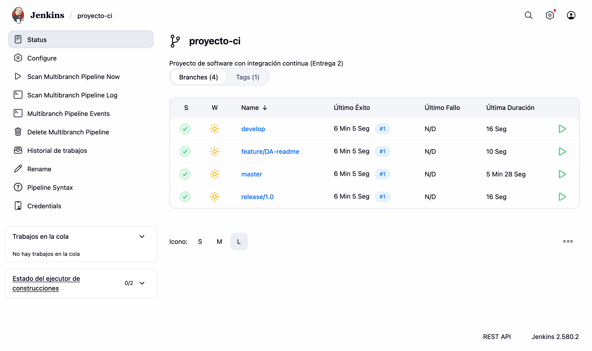
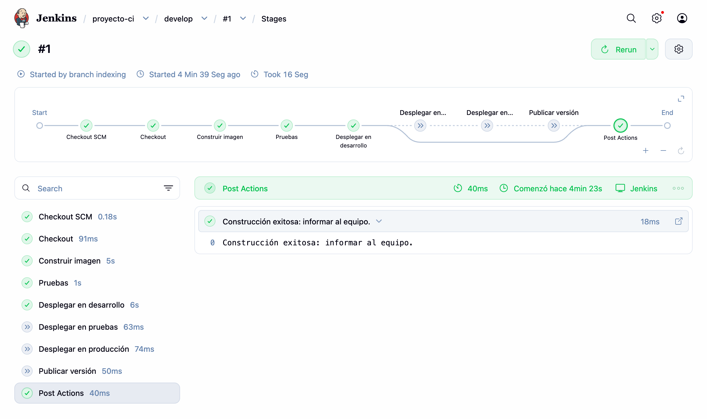
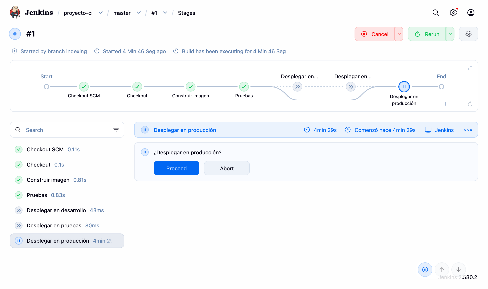
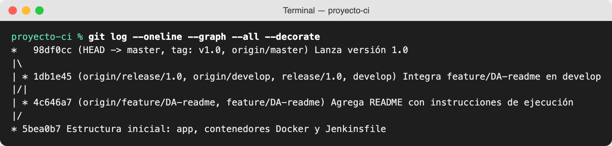

# Proyecto de software con integración continua

Proyecto del módulo **Énfasis Profesional I (Integración Continua)**, Politécnico Grancolombiano.

Es una aplicación de ejemplo con **dos contenedores Docker comunicados entre sí**. Su construcción, pruebas y despliegue se automatizan con **Jenkins** mediante un *Multibranch Pipeline*.

## Arquitectura

```
Navegador ──► web (Nginx, puerto PUERTO) ──► app (Python, puerto 5000)
```

- `app`: servicio HTTP en Python que responde un JSON.
- `web`: proxy Nginx que publica la aplicación y se comunica con `app` por la red interna de Docker Compose.

## Estructura del repositorio

| Ruta | Contenido |
|---|---|
| `app/` | Código de la aplicación (`app.py`) y pruebas (`test_app.py`) |
| `web/` | Imagen de Nginx y su configuración |
| `scripts/pruebas.sh` | Ejecuta las pruebas dentro del contenedor |
| `Dockerfile` | Imagen de la aplicación |
| `docker-compose.yml` | Define los dos contenedores y el puerto de cada ambiente |
| `Jenkinsfile` | Pipeline declarativo de Jenkins |
| `jenkins/Dockerfile` | Imagen de Jenkins con Docker CLI y complementos |
| `evidencias/` | Capturas de la ejecución real del flujo |

## Ejecución local

```bash
PUERTO=8081 docker compose up -d --build
curl http://localhost:8081
```

Pruebas sin Docker:

```bash
cd app && python -m unittest -v
```

## Jenkins

```bash
docker network create red-ci
docker volume create jenkins_home
docker build -t jenkins-proyecto ./jenkins
docker run -d --name jenkins --network red-ci -p 8080:8080 -p 50000:50000 \
  -v jenkins_home:/var/jenkins_home \
  -v /var/run/docker.sock:/var/run/docker.sock --group-add 0 \
  jenkins-proyecto
```

Después se crea un trabajo *Multibranch Pipeline* que apunta a este repositorio. Jenkins descubre cada rama y etiqueta que tenga `Jenkinsfile`.

## Modelo de ramas y pipeline

| Rama | Propósito | Acción en Jenkins |
|---|---|---|
| `master` | Producción | Construir, probar y desplegar en el puerto 8083 con aprobación manual |
| `hotfix/*` | Corrección urgente de producción | Construir y probar |
| `release/*` | Versión candidata | Construir, probar y desplegar en pruebas (8082) |
| `develop` | Integración de funcionalidades | Construir, probar y desplegar en desarrollo (8081) |
| `feature/*` | Una funcionalidad o corrección | Construir y probar |
| Etiquetas `v*` | Versión publicada | Etiquetar la imagen con la versión |

Etapas del `Jenkinsfile`: **Checkout → Construir imagen → Pruebas → Despliegue según la rama → Publicar versión**.

## Evidencias

| | |
|---|---|
|  |  |
| Ramas descubiertas por el Multibranch Pipeline | Etapas del pipeline en `develop` |
|  |  |
| Pipeline de `master` en espera de aprobación | Historial de ramas con `git log --graph` |

La carpeta [`evidencias/`](evidencias/) contiene las 18 figuras del documento de la entrega.
